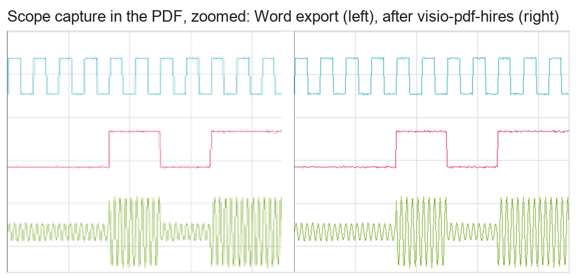

# visio-mac-rendering-fix

Two small tools for Visio figures in Word / PowerPoint / Excel files:

- **`visio-mac-rendering-fix`**: makes figures that render wrong in **Office for Mac** look right, without changing how they look on Windows.
- **`visio-pdf-hires`**: makes a PDF of a Word document with its photos and screenshots at full resolution, and its SVG pictures (tables, diagrams) as sharp vectors. Word for Mac's own PDF export shrinks pictures to about 200 ppi and turns SVGs into blurry bitmaps.

The example figure below is in `examples/` (a block diagram with a translucent highlight, plus a pasted oscilloscope capture), and the screenshots are from Word for Mac.




## Install

Requires Python 3.8+. Run it on the Mac (the fix reads the fonts installed there).

```bash
pip install "visio-mac-rendering-fix[pdf] @ git+https://github.com/yw-zz/visio-mac-rendering-fix"
```

Leave out `[pdf]` if you only need the Mac rendering fix. That installs only [fontTools](https://github.com/fonttools/fonttools); the `[pdf]` extra adds PyMuPDF, Pillow and numpy for `visio-pdf-hires`.

## visio-mac-rendering-fix

```bash
visio-mac-rendering-fix paper.docx
```

Writes `paper_macfix.docx` next to the input; the input is never modified. It accepts several files at once and `.docx` / `.pptx` / `.xlsx` (and their macro and template variants). Re-run it after you re-paste or edit a figure on Windows, because Office regenerates that figure's preview image.

Options: `-o OUT` names the output (single input), `--no-text` / `--no-transparency` apply only one of the two fixes, `--no-glyph-index` leaves labels stored as glyph indices alone, `--font-dir DIR` searches other font folders.

**The conversion is reversible**, so it's fine to keep working in the `_macfix` copy. Each changed figure keeps its original records inside comments that renderers ignore, and

```bash
visio-mac-rendering-fix --undo paper_macfix.docx
```

writes `paper_macfix_original.docx` with every figure restored byte for byte. `visio-pdf-hires` does this automatically before exporting, so PDFs always get real figure text. Files converted by version 0.4 or earlier kept no undo data; add `--originals OLDER.docx` (any unconverted copy of the document) to `--undo` or to `visio-pdf-hires`, and each figure is recovered from the original that converts to exactly the same bytes.

### Why figures look wrong on the Mac

Visio puts each figure into the Office file as an OLE object whose preview is a *dual* EMF: a modern **EMF+** layer plus an old **GDI** fallback layer.

| | Draws |
|---|---|
| Office for Windows | EMF+ layer (text comes from GDI records inside EMF+ `GetDC` sections) |
| Office for Mac, PDF export | EMF+ layer (same as Windows), so exported PDFs look right |
| Office for Mac, **on screen** | GDI fallback layer only |

The GDI fallback has two problems on the Mac:

1. **Fonts.** Text is GDI `EXTTEXTOUTW` records naming a font family. Office for Mac resolves it through its own bundled fonts first. Its bundled *Arial Narrow* contains only the Italic and Bold Italic faces, so regular labels come out italic. Installing the regular font yourself does not help.
2. **Transparency.** GDI has no alpha, so Visio fakes a translucent shape with raster operations: XOR the bounding box with the color, AND-fill the shape with an 8×8 checkerboard, XOR again. The Mac on-screen renderer ignores raster operations and paints the whole box solid, hiding whatever is under it.

### What it changes

Only the EMF images inside the Office file are rewritten; text, layout and everything else are copied byte for byte.

- **Text → outlines, drawn twice.** Each text run whose font is installed becomes glyph outlines, using the per-character positions stored in the figure:
  - an anti-aliased EMF+ path fill in the same pixel coordinates, which Windows and PDF export draw;
  - a GDI path fill placed outside the `GetDC` section, which only the Mac's screen view draws.
  The `GetDC` section is then reopened, so the original GDI state records still run on Windows.
- **Stipple transparency → plain fill.** In the GDI fallback, the raster-op trick becomes an ordinary fill of the same shape with the color pre-blended 50% with white. Other stipple variants are dropped. The EMF+ layer, which holds the real transparency, is not touched.

### Limitations

- In the converted file, figure text is vector outlines, so a PDF exported directly from it (File › Save As › PDF) has unselectable figure text. Make PDFs with `visio-pdf-hires` instead, which exports from the restored originals.
- On the Mac **screen** only, translucent shapes become opaque light fills, so anything underneath them is hidden there. Windows and PDF export keep the real transparency.
- Text in fonts that are not installed on the machine running the tool is left as text (the tool lists those fonts).
- Only dual EMF+ images (what Visio and other GDI+ apps produce) are changed. Plain EMF, WMF, and `.emz` previews are left alone.

## visio-pdf-hires

```bash
visio-pdf-hires paper.docx
```

On a Mac with Word installed, that's all: it writes `paper_hires.pdf` next to the document. It works on `_macfix` copies too: figures converted by `visio-mac-rendering-fix` are restored first, so their text is real, selectable text in the PDF. Behind the scenes Word exports a temporary copy of the file, with tracked changes applied and markup hidden (`--keep-markup` keeps your current markup view instead), and then the pictures are restored. Your open documents are never touched; the copy and its PDF are deleted afterwards. It also prints how many pages Word laid the document out on, handy for page limits. The first run asks you to allow your terminal to control Microsoft Word (System Settings › Privacy & Security › Automation).

On Windows, or for a `.pptx` / `.xlsx`, export the PDF yourself and give it both files, in either order:

```bash
visio-pdf-hires paper.docx paper.pdf
```

### Layout check

Before restoring pictures, the tool checks Word's export for text drawn on top of other text and warns, naming the page and the colliding words. That is the symptom of a Word layout problem the PDF would otherwise hide in plain sight: Word does not keep floating objects (frames, floating tables, anchored pictures) from overlapping. A typical case is a two-column paper whose figures are frames aligned to the top of a column. When an edit shortens the text above (for example, replacing the author block with a one-line placeholder for a blind submission), a frame's anchor can move back onto a page whose column top is already taken, and Word draws both frames in the same place. To pin such a frame to the following page, turn on **Page break before** for its first paragraph (Format › Paragraph › Line and Page Breaks).

### How it works

Word's PDF export resamples every bitmap inside an EMF figure (photos, scope or simulator screenshots pasted into Visio) to about 200 ppi and often JPEG-compresses it, so thin traces turn blurry and blocky. The originals are still stored losslessly in each figure's EMF+ layer inside the `.docx`. The tool:

1. reads every embedded bitmap and where each figure draws it;
2. looks for a **larger original inside the embedded Visio drawing**: when Visio writes a figure's preview it shrinks big pictures (a 2828 × 1767 render can end up as 707 × 442, which breaks up thin lines), but the drawing itself (the `.vsdx` stored in the `.docx`) keeps the full-size file. Originals are matched by appearance in any rotation or mirror orientation;
3. matches each picture in the PDF to its original, by appearance and, for pictures Word cropped or squeezed, by position on the page;
4. swaps in the original pixels: lossless sources (PNG renders, screenshots, line art) stay lossless, JPEG photos stay JPEG, and transparency masks are kept. Pictures above `--max-ppi` (default 1200, which is beyond print quality) are scaled down to it to keep the file size reasonable; `--max-ppi 0` keeps full size.

Vector content (lines, shapes, text) is never touched, nor are pictures it cannot match confidently (`--min-similarity`, default 0.97). The page layout is unchanged; only the pictures get sharper. The PDF grows by the size of the restored pictures.

**SVG pictures** (for example a table pasted as SVG) are stored in the `.docx` as the SVG plus a PNG fallback, and Word for Mac exports them as a ~200 ppi bitmap. The tool matches that bitmap to the fallback and puts the SVG back in its place as vectors: shapes are drawn by MuPDF's SVG renderer, and text is drawn by the tool with the real installed fonts (embedded, selectable and searchable), because MuPDF's SVG renderer only has the standard PDF fonts and would set e.g. Arial Narrow in a wider substitute. Supported text features: `text-anchor`, `tspan` with `dx`/`dy`/font changes (sub- and superscripts), `transform` (rotated labels), and per-character font fallback along the `font-family` list. Cropped or rotated SVG pictures are left as they are.

**Plain pictures** placed directly in the document (PNG, JPEG, TIFF, BMP) are restored the same way, from the file stored in the `.docx`. Useful tip: if a Visio figure contains photos or renders that look bad on the Mac screen, export the figure as a high-resolution PNG and place that instead; `visio-pdf-hires` keeps it at full resolution in the PDF.

## Try it

`examples/make_demo.py` builds the example figure and `demo.docx` / `demo.pptx` that embed it (needs Pillow, python-docx and python-pptx).

```bash
python3 examples/make_demo.py examples
visio-mac-rendering-fix examples/demo.docx examples/demo.pptx
```

Open `demo.docx` and `demo_macfix.docx` in Word for Mac to compare. Then run `visio-pdf-hires examples/demo.docx` and zoom into the scope capture in `examples/demo_hires.pdf`.

Tests: `python3 -m unittest discover tests` (add `VPH_TEST_WORD=1` to also test the Word export, which opens Word)

Tested with Office for Mac 16.x (Word, PowerPoint) on real Visio figures, and with Word for Windows for the rendering fix.

## License

MIT. The optional `[pdf]` extra installs [PyMuPDF](https://pymupdf.readthedocs.io), which is licensed separately under the AGPL (or a commercial license from Artifex).
