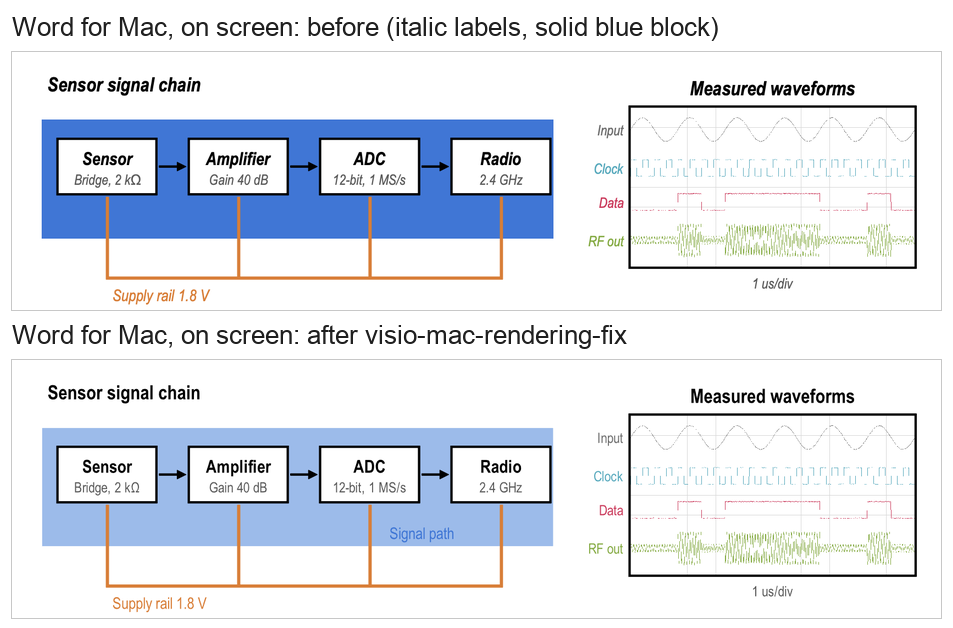

# visio-mac-rendering-fix

Two small tools for Visio figures in Word / PowerPoint / Excel files:

- **`visio-mac-rendering-fix`**: makes figures that render wrong in **Office for Mac** look right, without changing how they look on Windows.
- **`visio-pdf-hires`**: puts full-resolution photos and screenshots back into a PDF exported from Word, which otherwise shrinks them to about 200 ppi.

The example figure below is in `examples/` (a block diagram with a translucent highlight, plus a pasted oscilloscope capture), and the screenshots are from Word for Mac.




## Install

Requires Python 3.8+. Run it on the Mac (the fix reads the fonts installed there).

```bash
pip install "visio-mac-rendering-fix[pdf] @ git+https://github.com/yw-zz/visio-mac-rendering-fix"
```

Leave out `[pdf]` if you only need the Mac rendering fix. That installs only [fontTools](https://github.com/fonttools/fonttools); the `[pdf]` extra adds PyMuPDF, Pillow and numpy for `visio-pdf-hires`.

## visio-mac-rendering-fix

```bash
visio-mac-rendering-fix paper.docx
```

Writes `paper_macfix.docx` next to the input; the input is never modified. It accepts several files at once and `.docx` / `.pptx` / `.xlsx` (and their macro and template variants). Re-run it after you re-paste or edit a figure on Windows, because Office regenerates that figure's preview image.

Options: `-o OUT` names the output (single input), `--no-text` / `--no-transparency` apply only one of the two fixes, `--no-glyph-index` leaves labels stored as glyph indices alone, `--font-dir DIR` searches other font folders.

### Why figures look wrong on the Mac

Visio puts each figure into the Office file as an OLE object whose preview is a *dual* EMF: a modern **EMF+** layer plus an old **GDI** fallback layer.

| | Draws |
|---|---|
| Office for Windows | EMF+ layer (text comes from GDI records inside EMF+ `GetDC` sections) |
| Office for Mac, PDF export | EMF+ layer (same as Windows), so exported PDFs look right |
| Office for Mac, **on screen** | GDI fallback layer only |

The GDI fallback has two problems on the Mac:

1. **Fonts.** Text is GDI `EXTTEXTOUTW` records naming a font family. Office for Mac resolves it through its own bundled fonts first. Its bundled *Arial Narrow* contains only the Italic and Bold Italic faces, so regular labels come out italic. Installing the regular font yourself does not help.
2. **Transparency.** GDI has no alpha, so Visio fakes a translucent shape with raster operations: XOR the bounding box with the color, AND-fill the shape with an 8×8 checkerboard, XOR again. The Mac on-screen renderer ignores raster operations and paints the whole box solid, hiding whatever is under it.

### What it changes

Only the EMF images inside the Office file are rewritten; text, layout and everything else are copied byte for byte.

- **Text → outlines, drawn twice.** Each text run whose font is installed becomes glyph outlines, using the per-character positions stored in the figure:
  - an anti-aliased EMF+ path fill in the same pixel coordinates, which Windows and PDF export draw;
  - a GDI path fill placed outside the `GetDC` section, which only the Mac's screen view draws.
  The `GetDC` section is then reopened, so the original GDI state records still run on Windows.
- **Stipple transparency → plain fill.** In the GDI fallback, the raster-op trick becomes an ordinary fill of the same shape with the color pre-blended 50% with white. Other stipple variants are dropped. The EMF+ layer, which holds the real transparency, is not touched.

### Limitations

- Figure text becomes vector outlines, so it can no longer be selected or searched in an exported PDF. It looks the same.
- On the Mac **screen** only, translucent shapes become opaque light fills, so anything underneath them is hidden there. Windows and PDF export keep the real transparency.
- Text in fonts that are not installed on the machine running the tool is left as text (the tool lists those fonts).
- Only dual EMF+ images (what Visio and other GDI+ apps produce) are changed. Plain EMF, WMF, and `.emz` previews are left alone.

## visio-pdf-hires

```bash
visio-pdf-hires paper.pdf paper.docx
```

Give it the PDF exported from Word and the `.docx` (or `.pptx`) it came from. It writes `paper_hires.pdf`.

Word's PDF export resamples every bitmap inside an EMF figure (photos, scope or simulator screenshots pasted into Visio) to about 200 ppi and often JPEG-compresses it, so thin traces turn blurry and blocky. The originals are still stored losslessly in each figure's EMF+ layer inside the `.docx`. The tool:

1. reads every embedded bitmap and where each figure draws it;
2. matches each picture in the PDF to its original, by appearance and, for pictures Word cropped or squeezed, by position on the page;
3. swaps in the original pixels: screenshots and line art stay lossless, photos become high-quality JPEG, and transparency masks are kept.

Vector content (lines, shapes, text) is never touched, nor are pictures it cannot match confidently (`--min-similarity`, default 0.97). The page layout is unchanged; only the pictures get sharper. The PDF grows by the size of the restored pictures.

## Try it

`examples/make_demo.py` builds the example figure and `demo.docx` / `demo.pptx` that embed it (needs Pillow, python-docx and python-pptx).

```bash
python3 examples/make_demo.py examples
visio-mac-rendering-fix examples/demo.docx examples/demo.pptx
```

Open `demo.docx` and `demo_macfix.docx` in Word for Mac to compare. Export `demo.docx` to PDF from Word, then run `visio-pdf-hires demo.pdf examples/demo.docx` and zoom into the scope capture.

Tests: `python3 -m unittest discover tests`

Tested with Office for Mac 16.x (Word, PowerPoint) on real Visio figures, and with Word for Windows for the rendering fix.

## License

MIT. The optional `[pdf]` extra installs [PyMuPDF](https://pymupdf.readthedocs.io), which is licensed separately under the AGPL (or a commercial license from Artifex).
