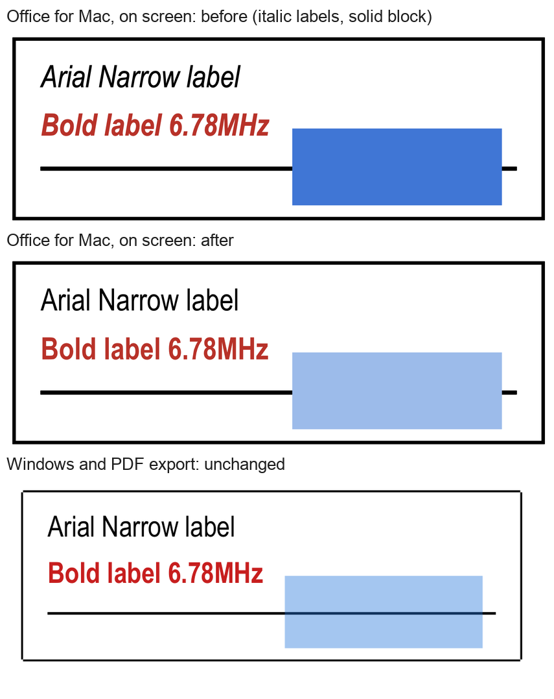

# visio-mac-rendering-fix

Fixes Visio figures that render wrong in **Word / PowerPoint / Excel for Mac** while looking fine on Windows.



Typical symptoms when a figure was pasted from Visio on Windows and the file is opened on a Mac:

- every label in the figure shows in *italic* (most visible with Arial Narrow);
- translucent shapes (highlighted paths, shaded regions) turn into solid colored blocks or bars.

The tool writes a corrected copy of your `.docx` / `.pptx` / `.xlsx`. The figures then look right on the Mac screen, while Windows and PDF export draw them the same as before.

## Install

Requires Python 3.8+ and [fontTools](https://github.com/fonttools/fonttools). Run it on the Mac (it reads the fonts installed there).

```bash
pip install git+https://github.com/yw-zz/visio-mac-rendering-fix
```

## Use

```bash
visio-mac-rendering-fix paper.docx
```

This writes `paper_macfix.docx` next to the input; the input is never modified. Several files at once, or an explicit output name:

```bash
visio-mac-rendering-fix slides.pptx paper.docx
visio-mac-rendering-fix paper.docx -o paper_for_mac.docx
```

Re-run it after you re-paste or edit a figure on Windows, because Office regenerates that figure's preview image.

Options: `--no-text` / `--no-transparency` apply only one of the two fixes, `--no-glyph-index` leaves labels stored as glyph indices alone, `--font-dir DIR` searches other font folders. Run with `-h` for the full list. Without installing: `python3 -m visio_mac_rendering_fix paper.docx` from the `src` folder.

## Why it happens

Visio puts each figure into the Office file as an OLE object whose preview is a *dual* EMF: a modern **EMF+** layer plus an old **GDI** fallback layer.

| | Draws |
|---|---|
| Office for Windows | EMF+ layer (text comes from GDI records inside EMF+ `GetDC` sections) |
| Office for Mac, PDF export | EMF+ layer (same as Windows), so exported PDFs look right |
| Office for Mac, **on screen** | GDI fallback layer only |

The GDI fallback has two problems on the Mac:

1. **Fonts.** Text is GDI `EXTTEXTOUTW` records naming a font family. Office for Mac resolves it through its own bundled fonts first. Its bundled *Arial Narrow* contains only the Italic and Bold Italic faces, so regular labels come out italic. Installing the regular font yourself does not help.
2. **Transparency.** GDI has no alpha, so Visio fakes a translucent shape with raster operations: XOR the bounding box with the color, AND-fill the shape with an 8×8 checkerboard, XOR again. The Mac on-screen renderer ignores raster operations and paints the whole box solid.

## What the tool changes

Only the EMF images inside the Office file are rewritten; text, layout and everything else are copied byte for byte.

- **Text → outlines, drawn twice.** Each text run whose font is installed becomes glyph outlines, using the per-character positions stored in the figure:
  - an anti-aliased EMF+ path fill in the same pixel coordinates, which Windows and PDF export draw;
  - a GDI path fill placed outside the `GetDC` section, which only the Mac's screen view draws.
  The `GetDC` section is then reopened, so the original GDI state records still run on Windows.
- **Stipple transparency → plain fill.** In the GDI fallback, the raster-op trick becomes an ordinary fill of the same shape with the color pre-blended 50% with white. Other stipple variants are dropped. The EMF+ layer, which holds the real transparency, is not touched.

## Limitations

- Figure text becomes vector outlines, so it can no longer be selected or searched in an exported PDF. It looks the same.
- On the Mac **screen** only, translucent shapes become opaque light fills, so anything underneath them is hidden there. Windows and PDF export keep the real transparency.
- Text in fonts that are not installed on the machine running the tool is left as text (the tool lists those fonts).
- Only dual EMF+ images (what Visio and other GDI+ apps produce) are changed. Plain EMF, WMF, and the `.emz` previews some apps use are left alone.

Tested on Office for Mac 16.x (Word, PowerPoint) with figures from Visio, and on Word for Windows.

## Try it

`examples/make_demo.py` builds a small Visio-style figure and `demo.docx` / `demo.pptx` that embed it (needs `python-docx` and `python-pptx` for the Office files). Open the demo files on a Mac before and after running the tool.

```bash
python3 examples/make_demo.py examples
visio-mac-rendering-fix examples/demo.docx examples/demo.pptx
```

Tests: `python3 -m unittest discover tests`

## License

MIT
